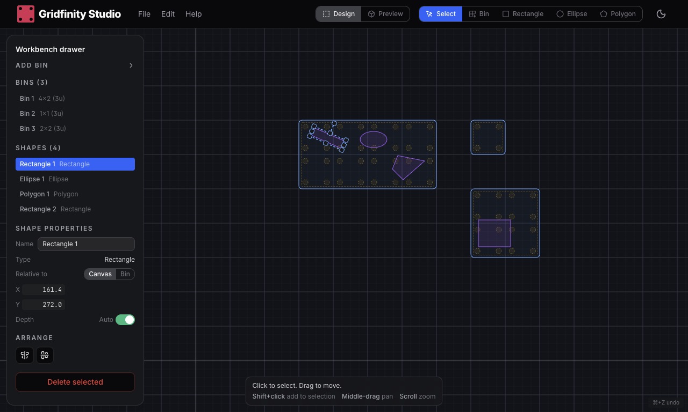
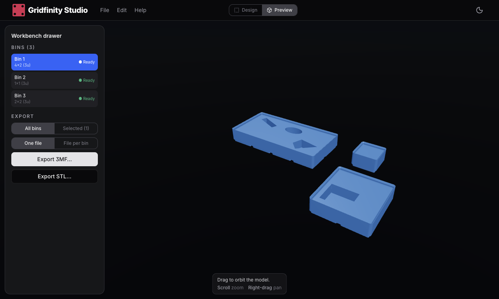

# Gridfinity Studio

A desktop app for designing [Gridfinity](https://gridfinity.xyz) bins with custom pockets. Lay out bins on a grid, draw the pockets your tools need, check the result in 3D, and export it for printing.

Runs on macOS, Windows and Linux.





## What it does

- **Bins on a grid.** Add bins from a size picker or draw them on the canvas. Bins snap to the grid and can't overlap.
- **Pockets.** Draw rectangles, ellipses and polygons inside a bin. Each one is cut into the bin to its own depth.
- **3D preview.** See the finished bins, with the stacking lip, feet, and magnet and screw holes.
- **Export.** Save 3MF or STL: every bin or only the selected ones, in one file or one file per bin.
- **Projects.** Work is saved as a `.gfstudio` file, with undo, redo, cut, copy and paste.

## Install

Download the latest version from [Releases](https://github.com/unstable-studios/gridfinity-studio/releases/latest).

| Platform | File                                    | Notes                                                  |
| -------- | --------------------------------------- | ------------------------------------------------------ |
| macOS    | `gridfinity-studio-<version>.dmg`       | Apple silicon. Signed and notarized.                   |
| Windows  | `gridfinity-studio-<version>-setup.exe` | Not code signed, so Windows may ask before running it. |
| Linux    | `.AppImage`, `.deb` or `.snap`          | x64.                                                   |

The app checks for updates when it starts and offers to restart when one is ready.

## Using it

1. **Start a project.** Choose **New project**, then give it a name, a base unit and a tolerance.
2. **Add a bin.** Pick a size in the sidebar, or choose the **Bin** tool and drag on the canvas. Select a bin to change its width, depth and height, or to turn the stacking lip off.
3. **Draw pockets.** Choose **Rectangle**, **Ellipse** or **Polygon** and draw inside the bin. Hold Shift for a square or circle, and Alt (Option on a Mac) to draw from the center. Select a pocket to set its depth and position.
4. **Preview.** Switch to **Preview** to see the bins in 3D. Drag to orbit and scroll to zoom.
5. **Export.** In Preview, choose **Export 3MF…** or **Export STL…**. With more than one bin you can export only the selected bins, or one file per bin.

Tolerance, unit height, and magnet and screw holes are set per project in **Edit > Preferences…**. The base unit can be changed there only while the project has no bins.

## Build from source

You need [pnpm](https://pnpm.io), which installs the right Node version for the project, and a GitHub token.

The UI library is published on GitHub Packages, which asks for a token even for public packages. Create a [personal access token (classic)](https://docs.github.com/en/packages/working-with-a-github-packages-registry/working-with-the-npm-registry#authenticating-to-github-packages) with the `read:packages` scope and add this line to `~/.npmrc`:

```ini
//npm.pkg.github.com/:_authToken=YOUR_TOKEN
```

Then:

```bash
pnpm install
```

```bash
pnpm dev
```

Before sending a change, run the full check. It runs the typecheck, lint and unit tests, then builds the app and drives it with Playwright.

```bash
pnpm verify
```

To package an installer for your platform, run `pnpm build:mac`, `pnpm build:win` or `pnpm build:linux`.

[CLAUDE.md](CLAUDE.md) describes the architecture, and [docs/PROJECT_SCHEMA.md](docs/PROJECT_SCHEMA.md) the project file format.

## Contributing

Commits follow [Conventional Commits](https://www.conventionalcommits.org), checked in CI: `type(scope): subject`. [CONTRIBUTING.md](CONTRIBUTING.md) has the details. Open pull requests against `main`.
